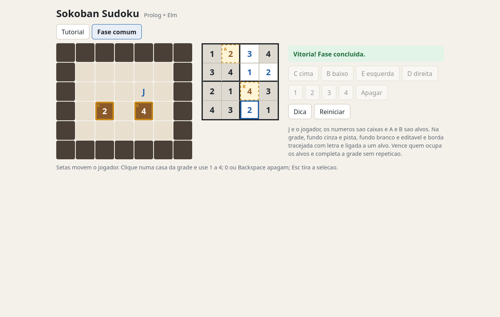

# Sokoban Sudoku

Trabalho final do grupo Grandma's Boys 1 em Paradigmas de Computação (UnB, 2026-2).
O jogo junta um armazém de Sokoban a um Sudoku 4x4. Cada caixa tem um número. Quando
a caixa ocupa o alvo A ou B do armazém, o número dela aparece na casa A ou B da grade.
A fase só termina quando os alvos estão ocupados e a grade está completa e sem
repetição. Uma caixa certa no alvo errado faz a grade se contradizer.

- **Prolog** decide tudo o que é regra: passos legais, empurrões, a ligação entre
  caixas e grade, a verificação do Sudoku com CLP(FD), a vitória e a busca em
  largura que encontra rotas e impasses.
- **Elm** desenha os dois tabuleiros, guarda as entradas do jogador e conversa com
  a API.
- **Python** (FastAPI + Janus) só valida o formato do JSON e chama o Prolog.



## Requisitos

- SWI-Prolog 9.2 ou mais novo (testado com 10.0.2);
- uv (testado com 0.12.5), que instala o Python (testado com 3.13);
- Node.js 20 ou mais novo, com npm (testado com Node 24.19.0 e npm 11.21.3).

## Como rodar

```sh
make install
make dev
```

Abra http://localhost:5173. A documentação da API fica em http://localhost:8000/docs.

## Testes e conferências

```sh
make test       # plunit de todas as suites, pytest e elm-test
make formato    # elm-format --validate
make build      # build de producao do frontend
make ascii      # caracteres ASCII nos arquivos de codigo, testes e interface
make validar    # forma do RELATORIO.md
```

## Estrutura

```
backend/prolog/grade.pl         Sudoku 4x4 com CLP(FD)
backend/prolog/motor.pl         armazem, passos, busca em largura, ligacao, vitoria, dica
backend/prolog/api.pl           fronteira com o Python (termos viram listas)
backend/prolog/registro.pl      registro central das fases
backend/prolog/fases/           uma fase por arquivo, com testes test_<id>.pl
backend/app/                    FastAPI e Janus
frontend/src/Jogo.elm           dominio puro: tipos e regras de exibicao
frontend/src/Ajuda.elm          contrato da ajuda e dos modulos de diagnostico
frontend/src/Api.elm            HTTP, decoders e encoders
frontend/src/Tabuleiros.elm     desenho do armazem e da grade
frontend/src/Main.elm           Arquitetura Elm (Model, Msg, update, view)
frontend/src/Registro.elm       registro central dos modulos Elm
frontend/src/Fases/             um modulo de diagnostico por fase
```

## API

| Rota | Corpo | Resposta |
|------|-------|----------|
| `GET /api/fases` | | lista de fases |
| `GET /api/fases/{id}` | | armazém, Sudoku e estado inicial |
| `POST /api/jogada` | fase, estado, direção | novo estado, movimento, situação |
| `POST /api/situacao` | fase, estado | situação |
| `POST /api/dica` | fase, estado | ajuda |
| `POST /api/diagnostico` | fase, estado, consulta | ajuda do módulo da fase |

Linha e coluna começam em 1 e a casa (1,1) é o canto superior esquerdo. Zero
representa casa vazia. Os exemplos completos de entrada, saída e erro estão no
guia do grupo e nos testes em `backend/tests/test_api.py`.

## Créditos

A estrutura parte do repositório-modelo do professor Fábio Macêdo Mendes
(`paradigmas-trabalho-final`, commit 8454eea): Makefile, ponte FastAPI e Janus,
configuração do Vite com Elm, `scripts/validar_entrega.py`, `AVALIACAO.md` e o
modelo de `RELATORIO.md`. A função `esperar` de `frontend/src/Api.elm` adapta
`expectJson` e `errorDetail` do `Api.elm` do modelo. O restante do código foi
escrito para este projeto com uso intensivo de IA, declarado na seção 11 do
relatório.
