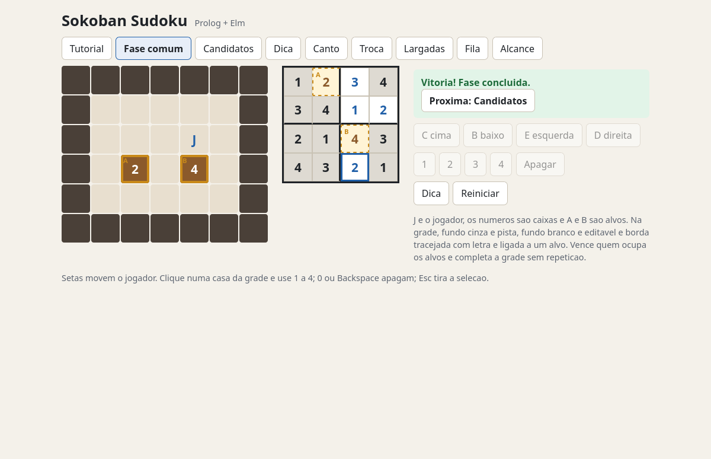
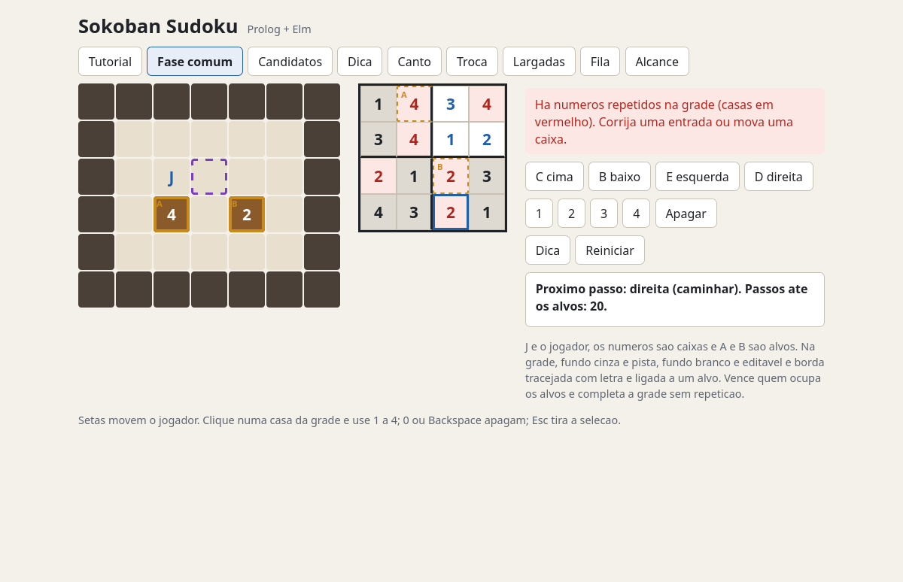

# Sokoban Sudoku

## 1. Identificação

| Nome completo | Matrícula | Turma (14h/16h) | Usuário GitHub |
|---------------|-----------|-----------------|----------------|
| Leonardo de Melo Lima | 222037700 | 16h | @leozinlima |
| Vitor Carvalho Pereira | 211062615 | 16h | @vcpVitor |
| Mateus Bastos dos Santos | 211062240 | 16h | @MateuSansete |
| Thales Germano Vargas Lima | 202017147 | 16h | @thalesgvl |
| Gabriel Moura dos Santos | 221008060 | 16h | @thegm445 |
| Vitor Pereira Bessa | 180132466 | 16h | @Bessazs |
| Carlos Eduardo de Sousa Paz | 222022064 | 16h | @dudupaz |

- **Nome do projeto:** Sokoban Sudoku
- **Nome do grupo:** Grandma's Boys 1
- **Repositório:** https://github.com/Grandma-s-Boys-1/TRABALHO_PARADIGMAS
- **Commit ou tag entregue:** `6a8bdfb15e0aec85eac3778dae48efd33616dcbd`
- **Ponto de partida:** remix original
- **Slides da apresentação oral:** `docs/apresentacao.pdf`

## 2. Resumo

O jogo junta um armazém de Sokoban a um Sudoku 4x4. Cada caixa tem um número: quando ocupa o
alvo A ou B do armazém, esse número aparece na casa A ou B da grade. A fase termina só com os
alvos ocupados e a grade completa e sem repetição. A versão entregue tem nove fases: o tutorial
(regra clássica, sem grade), a fase comum e sete fases individuais, cada uma com um diagnóstico
próprio escrito em Prolog e exibido em Elm. O Prolog decide as regras, confere a grade com
CLP(FD) e faz a busca em largura que encontra rotas, dicas e impasses.

Os mesmos alvos ocupados podem dar resultados diferentes. Na fase comum, com as quatro entradas
corretas (L1C3 = 3, L2C3 = 1, L2C4 = 2, L4C3 = 2), o percurso EBCDDB leva a caixa 2 ao alvo A e a
caixa 4 ao alvo B e vence. O percurso EBEBDDCCDDBEECEB ocupa os mesmos alvos com as caixas
trocadas: A recebe 4, B recebe 2 e a grade repete números nas linhas 1 e 3, nas colunas 2 e 3 e
nos blocos 1 e 4. O tutorial, que não tem grade, aceita as duas posições.





## 3. Como executar

**Requisitos** (com as versões que o grupo usou):

- SWI-Prolog 10.0.2 (funciona a partir da 9.2)
- Node.js 24.19.0 com npm 11.21.3
- uv 0.12.5, que instala o Python 3.13.9 e as dependências do backend (FastAPI e janus-swi)
- Elm 0.19.2, elm-format 0.8.8, elm-test 0.19.2-1 e Vite 8.3.1, instalados pelo npm a partir de
  `frontend/package.json`

**Instalação e execução:**

```sh
make install
make dev
```

O `make dev` sobe o backend em http://localhost:8000 e o frontend em http://localhost:5173. Sem
make, use dois terminais: `cd backend && uv sync && uv run fastapi dev app/main.py` e
`cd frontend && npm install && npm run dev`.

**Testes:**

```sh
make test       # plunit de todas as suites, pytest e elm-test
make formato    # elm-format --validate src tests
make build      # build de producao do frontend
make ascii      # so ASCII nos arquivos de codigo, testes e interface
make validar    # forma deste relatorio
```

**Testado em:** Linux, com SWI-Prolog 10.0.2, Python 3.13.9 e Node 24.19.0, e Firefox 157 em
24/11/2026.

## 4. Arquitetura

```
[Elm no navegador] --HTTP/JSON--> [FastAPI (Python)] --janus--> [Prolog]
```

| Parte  | Responsabilidade | Arquivos principais |
|--------|------------------|---------------------|
| Prolog | Todas as regras: passos legais, empurrões, ligação entre caixas e grade, Sudoku com CLP(FD), vitória, busca em largura, dica e o diagnóstico de cada fase. | `backend/prolog/motor.pl`, `backend/prolog/grade.pl`, `backend/prolog/api.pl`, `backend/prolog/registro.pl`, `backend/prolog/fases/` |
| Elm    | Desenha o armazém e a grade, guarda as entradas do jogador, envia jogadas e consultas e exibe a ajuda de cada módulo. | `frontend/src/Main.elm`, `frontend/src/Jogo.elm`, `frontend/src/Api.elm`, `frontend/src/Ajuda.elm`, `frontend/src/Tabuleiros.elm`, `frontend/src/Fases/` |
| Python | Só integração: valida o formato do JSON com Pydantic e chama `api.pl` pelo Janus. | `backend/app/main.py`, `backend/app/prolog.py` |

Cada fase individual é um módulo Prolog em `backend/prolog/fases/<id>.pl` e um módulo Elm em
`frontend/src/Fases/<Modulo>.elm`. As fases entram no jogo por dois registros:
`backend/prolog/registro.pl` lista os módulos Prolog e `frontend/src/Registro.elm` lista os
módulos Elm. O `api.pl` é a fronteira: transforma termos em listas e strings antes de devolvê-los
ao Python.

## 5. Parte em Prolog

### 5.1 Predicados principais

| Predicado | Local | O que faz |
|-----------|-------|-----------|
| `movimento(+Fase, +Estado, ?Direcao, ?Tipo, -Proximo)` | `backend/prolog/motor.pl:97` | Um passo legal. Tipo é `caminhada` ou `empurrao(N)`. |
| `caminho_minimo(:Passo, +Inicio, :Objetivo, -Caminho)` | `backend/prolog/motor.pl:113` | Busca em largura com fila e visitados (`library(assoc)`). |
| `grade_atual(+Fase, +Estado, -Grade)` | `backend/prolog/motor.pl:168` | Grade com pistas, entradas e números das caixas nos alvos. |
| `pronto(+Fase, +Estado)` | `backend/prolog/motor.pl:189` | Alvos ocupados e grade que ainda admite conclusão. |
| `vitoria(+Fase, +Estado)` | `backend/prolog/motor.pl:194` | Alvos ocupados e grade completa e válida. |
| `rota_vencedora(+Fase, +Estado, -Caminho)` | `backend/prolog/motor.pl:214` | Rota mínima até `pronto/2`; falha se não houver. |
| `dica(+Fase, +Estado, -Ajuda)` | `backend/prolog/motor.pl:242` | Próximo passo, revisão de entradas, impasse ou vitória. |
| `sudoku(?Linhas)` | `backend/prolog/grade.pl:24` | Restrições do Sudoku 4x4 com `ins` e `all_distinct`. |
| `admite_conclusao(+Grade)` | `backend/prolog/grade.pl:39` | A grade parcial tem ao menos uma conclusão. |
| `completa(+Grade)` | `backend/prolog/grade.pl:42` | Sem zeros e válida. |
| `candidatos(+Fase, +Estado, +Posicao, -Valores)` | `backend/prolog/fases/candidatos.pl:9` | Números de 1 a 4 que admitem conclusão numa casa (Leonardo). |
| `primeiro_empurrao(+Fase, +Estado, -Caminhada, -Numero, -Direcao)` | `backend/prolog/fases/dica.pl:9` | Caminhada e primeiro empurrão de uma rota mínima (Vitor Carvalho). |
| `presas_no_canto(+Fase, +Estado, -Presas)` | `backend/prolog/fases/canto.pl:10` | Caixas fora dos alvos presas entre duas paredes (Mateus). |
| `unidades_em_conflito(+Grade, -Nomes)` | `backend/prolog/fases/troca.pl:9` | Linhas, colunas e blocos com número repetido (Thales). |
| `largadas(+Fase, +Estado, -Opcoes)` | `backend/prolog/fases/largadas.pl:10` | Até dois primeiros empurrões que ainda vencem (Gabriel). |
| `bloqueio(+Fase, +Estado, +Direcao, -Motivo)` | `backend/prolog/fases/fila.pl:8` | Por que um passo fica bloqueado: parede, fila ou caixa na parede (Vitor Bessa). |
| `alcance(+Fase, +Estado, -Casas)` | `backend/prolog/fases/alcance.pl:9` | Casas que o jogador alcança sem mexer nas caixas (Carlos). |

### 5.2 Conceitos do paradigma lógico utilizados

- [x] Fatos e regras como base de conhecimento: `delta/3` (`backend/prolog/motor.pl:67` a 70), a
  fase de cada módulo em `fase/1` e o fato `limite(2)` (`backend/prolog/fases/largadas.pl:5`).
- [x] Unificação e casamento de padrões: as cabeças de `movimento/5`
  (`backend/prolog/motor.pl:97` e 100) desmontam `estado(J, Caixas, E)`; `numeros/3`
  (`backend/prolog/fases/fila.pl:34` a 37) casa `fila(N1, N2)`, `caixa_na_parede(N)`, `parede`
  e `livre`; `valores/4` (`backend/prolog/fases/candidatos.pl:14`) casa `pista(Valor)`.
- [x] Recursão (inclusive sobre listas): `largura/5` (`backend/prolog/motor.pl:118` e 122),
  `separar/6` (`backend/prolog/fases/dica.pl:13`), `casas/3` (`backend/prolog/fases/dica.pl:45`)
  e `visitar/5` (`backend/prolog/fases/alcance.pl:13`).
- [x] Backtracking e múltiplas soluções: `largada/5` (`backend/prolog/fases/largadas.pl:20`)
  gera cada caixa e cada direção por backtracking; `movimento/5` tem duas cláusulas e enumera
  caminhadas e empurrões.
- [x] `findall/3`, `bagof/3`, `setof/3` ou similares: `findall/3` em `largura/5`
  (`backend/prolog/motor.pl:124`) coleta os passos de toda a fronteira; em `candidatos/4`
  (`backend/prolog/fases/candidatos.pl:21`) com `between/3`; em `largadas/3`
  (`backend/prolog/fases/largadas.pl:15`) e em `alcance/3` (`backend/prolog/fases/alcance.pl:16`).
- [x] Corte (`!`) ou negação (`\+`), e por que foram necessários: o corte em `largura/5`
  (`backend/prolog/motor.pl:121`) fica com a primeira rota, que é a mínima; o corte em
  `casa_variavel/2` (`backend/prolog/grade.pl:47`) troca zero por variável, como no modelo; na
  fronteira, `backend/prolog/api.pl:32` escolhe uma única fase por id e `once/1` em
  `backend/prolog/api.pl:95` deixa `consulta/2` determinística. A negação aparece em `piso/2`
  (`backend/prolog/motor.pl:88`), `livre/3` (`backend/prolog/motor.pl:92`) e na exceção do canto
  que é alvo (`backend/prolog/fases/canto.pl:14`).
- [x] Programação por restrições (CLP(FD) ou outra): `sudoku/1` (`backend/prolog/grade.pl:24` a
  31) com `ins` e `all_distinct`, e `conclusao/2` (`backend/prolog/grade.pl:33`) com `label/1`.
- [x] Predicados de ordem superior (`maplist`, `foldl`, `include`): `foldl/4` e `exclude/3` em
  `largura/5` (`backend/prolog/motor.pl:129` e 130), `maplist/3` em `grade_atual/3`
  (`backend/prolog/motor.pl:170`), `include/3` em `presas_no_canto/3`
  (`backend/prolog/fases/canto.pl:11`) e em `unidades_em_conflito/2`
  (`backend/prolog/fases/troca.pl:11`), e os objetivos `passo(Fase)` e `pronto(Fase)` passados a
  `caminho_minimo/4` (`backend/prolog/motor.pl:214`).
- [x] Outro: a mesma busca serve a vários objetivos. `largadas/3` chama `caminho_minimo/4` com
  `caminhada(Fase)` e `jogador_em(Atras)` (`backend/prolog/fases/largadas.pl:26`).

### 5.3 Trecho em destaque

```prolog
movimento(Fase, estado(J, Caixas, E), Direcao, caminhada, estado(J1, Caixas, E)) :-
    vizinha(J, Direcao, J1),
    livre(Fase, Caixas, J1).
movimento(Fase, estado(J, Caixas, E), Direcao, empurrao(N), estado(J1, Caixas1, E)) :-
    vizinha(J, Direcao, J1),
    select(N-J1, Caixas, Outras),
    vizinha(J1, Direcao, Destino),
    livre(Fase, Outras, Destino),
    sort([N-Destino|Outras], Caixas1).

caminho_minimo(Passo, Inicio, Objetivo, Caminho) :-
    list_to_assoc([Inicio-sim], Visitados),
    largura(Passo, Objetivo, [Inicio-[]], Visitados, Inverso),
    reverse(Inverso, Caminho).

rota_vencedora(Fase, Estado, Caminho) :-
    caminho_minimo(passo(Fase), Estado, pronto(Fase), Caminho).
```

`movimento/5` (`backend/prolog/motor.pl:97`) declara o que é um passo legal, sem dizer como
procurá-lo. A primeira cláusula é uma caminhada para uma casa livre. A segunda é um empurrão: a
casa vizinha tem a caixa `N`, e a casa seguinte está livre das outras caixas. Não existe
cláusula para puxar caixa nem para empurrar duas caixas em fila, então esses passos simplesmente
não são deriváveis. As entradas são a fase e o estado; a direção e o tipo podem vir ligados ou
livres, e o Prolog enumera todos os passos possíveis quando estão livres.

`caminho_minimo/4` (`backend/prolog/motor.pl:113`) recebe o passo e o objetivo como objetivos
parciais. `largura/5` usa `findall/3` para expandir toda a fronteira, descarta estados já
visitados e para no primeiro estado que satisfaz o objetivo. Como a busca é em largura, a
primeira rota encontrada é mínima.

A solução numérica sozinha não fornece o caminho de empurrões. A grade inicial tem uma única
solução (teste `solucao_unica` em `backend/prolog/test_grade.pl:18`), e mesmo assim existem
posições sem rota: com a caixa 2 no canto (1,1), `rota_vencedora/3` falha (testes `sem_rota` em
`backend/prolog/test_motor.pl:91` e `impasse_no_canto` em
`backend/prolog/fases/test_canto.pl:19`). Existem também posições com os mesmos alvos ocupados
que perdem: as caixas trocadas (teste `caixas_trocadas` em `backend/prolog/test_motor.pl:61`).
Por isso a busca anda sobre estados físicos (jogador e caixas numeradas, com as entradas fixas)
e só no fim pergunta à grade, por `pronto/2`, se os números que as caixas escrevem admitem
conclusão. A chave do estado distingue o número de cada caixa (teste `chave_distingue_caixas`
em `backend/prolog/test_motor.pl:71`), e a busca nunca explora ordens de digitação.

## 6. Parte em Elm

### 6.1 Modelo e mensagens

```elm
type alias Model =
    { fases : List ResumoFase
    , numero : Int
    , tela : Tela
    }

type Tela
    = Carregando
    | Falha String
    | Jogando Partida

type alias Partida =
    { fase : Fase
    , estado : Estado
    , situacao : Situacao
    , envio : Envio
    , selecionada : Maybe Posicao
    , ajuda : Maybe Exibicao
    , aviso : Maybe String
    }

type Envio
    = Livre
    | Aguardando

type Msg
    = FasesRecebidas (Result String (List ResumoFase))
    | Escolher String
    | FaseRecebida Int (Result String Fase)
    | Mover Direcao
    | JogadaRecebida Int (Result String Resposta)
    | Selecionar Posicao
    | Desmarcar
    | Digitar (Maybe Int)
    | SituacaoRecebida Int (Result String Situacao)
    | PedirDica
    | Consultar Consulta
    | AjudaRecebida Int Origem (Result String Ajuda)
    | Reiniciar

type Casa
    = Pista Int
    | Editavel
    | Ligada String

type Regra
    = Classica
    | Combinada (Dict Posicao Casa)
```

Os tipos de `Main.elm` ficam em `frontend/src/Main.elm:27` a 84; `Casa` e `Regra` ficam em
`frontend/src/Jogo.elm:74` e 80.

- `Tela` é um custom type, e não um conjunto de Bools: a tela não pode estar carregando e
  jogando ao mesmo tempo, e a partida só existe dentro de `Jogando`.
- `Envio` (`Livre` ou `Aguardando`) bloqueia os comandos enquanto uma requisição espera
  resposta. Cada resposta traz o número da partida, e respostas de uma partida antiga são
  descartadas.
- `Ligada String` não tem campo de valor. Uma casa ligada não consegue guardar um número
  digitado; o número dela é calculado pela caixa no alvo. Uma fase `Classica` não tem grade, e a
  grade só existe dentro de `Combinada`.
- `selecionada : Maybe Posicao` diz se há uma casa escolhida sem usar posição inválida como
  sinal.

### 6.2 Conceitos do paradigma funcional utilizados

- [x] Arquitetura Elm (Model, update, view): `main`, `init`, `update`, `subscriptions` e `view`
  em `frontend/src/Main.elm:17`, 87, 106, 283 e 366.
- [x] Custom types e `case` exaustivo: `Tela` e `Envio` (`frontend/src/Main.elm:34` e 51), `Casa`
  (`frontend/src/Jogo.elm:74`) e `Motivo` com `descrever`
  (`frontend/src/Fases/Fila.elm:10` e 100).
- [x] `Maybe` e `Result` no lugar de null e exceções: `valorCasa` devolve `Maybe Int`
  (`frontend/src/Jogo.elm:260`), `digitar` devolve `Result Recusa Estado`
  (`frontend/src/Jogo.elm:277`) e `Api.resultado` (`frontend/src/Api.elm:227`).
- [x] Funções de ordem superior e aplicação parcial: `Api.pedirDiagnostico consulta`
  (`frontend/src/Main.elm:163`) vira uma requisição parcial; `teclas` usa `List.map`
  (`frontend/src/Fases/Candidatos.elm:18`) e `porLinha` usa `List.foldl`
  (`frontend/src/Fases/Alcance.elm:19`).
- [x] Composição (`|>`, `>>`): `resumo` (`frontend/src/Fases/Troca.elm:25`) e `porLinha`
  (`frontend/src/Fases/Alcance.elm:19`).
- [x] Decoders e encoders JSON: decoders próprios em `frontend/src/Api.elm:145` em diante e em
  cada módulo de fase, como `Decode.map4` (`frontend/src/Fases/Dica.elm:62`), `Decode.index`
  (`frontend/src/Fases/Largadas.elm:36`) e `Decode.andThen`
  (`frontend/src/Fases/Fila.elm:53`).
- [x] Comandos e subscriptions (efeitos controlados): requisições HTTP como `Cmd` em
  `frontend/src/Api.elm` e o teclado por `Browser.Events.onKeyDown`
  (`frontend/src/Main.elm:285`).
- [x] Imutabilidade e atualização de records: `digitar` devolve um novo estado com
  `{ estado | entradas = Dict.update posicao (always valor) estado.entradas }`
  (`frontend/src/Jogo.elm:281`).

### 6.3 Trecho em destaque

```elm
valorCasa : Fase -> Estado -> Posicao -> Maybe Int
valorCasa fase estado posicao =
    case casaEm fase posicao of
        Just (Pista valor) ->
            Just valor

        Just Editavel ->
            Dict.get posicao estado.entradas

        Just (Ligada letra) ->
            -- Ler a caixa no alvo evita guardar o mesmo numero em dois lugares.
            caixaNoAlvo fase.armazem estado letra

        Nothing ->
            Nothing


digitar : Fase -> Posicao -> Maybe Int -> Estado -> Result Recusa Estado
digitar fase posicao valor estado =
    case casaEm fase posicao of
        Just Editavel ->
            Ok { estado | entradas = Dict.update posicao (always valor) estado.entradas }

        Just (Pista fixo) ->
            Err (PistaFixa fixo)

        Just (Ligada letra) ->
            Err (LigadaAoAlvo letra)

        Nothing ->
            Err SemGrade
```

`valorCasa` (`frontend/src/Jogo.elm:260`) calcula o que aparece em cada casa da grade. Uma pista
mostra o próprio valor, uma casa editável mostra a entrada do jogador, e uma casa ligada mostra
o número da caixa que está no alvo correspondente. Como `Ligada` não guarda valor, tirar a
caixa do alvo limpa a casa sem nenhum código extra: o valor nunca foi copiado.

`digitar` (`frontend/src/Jogo.elm:277`) só aceita casas editáveis. Para pista, casa ligada ou
fase sem grade, devolve `Err` com o motivo, e a tela transforma a recusa em mensagem. O `case`
precisa tratar os quatro casos, e o compilador recusa o código se um deles faltar.

## 7. Integração

| Rota / chamada | Entrada | Saída | Predicado Prolog |
|----------------|---------|-------|------------------|
| `GET /api/fases` | nada | lista de `{id, nome, regra}` com as nove fases | `api:listar/1` (`backend/prolog/api.pl:17`) |
| `GET /api/fases/{id}` | id na URL | armazém, Sudoku (`null` no tutorial) e estado inicial; 404 se a fase não existe | `api:dados/7` (`backend/prolog/api.pl:38`) |
| `POST /api/jogada` | `{fase, estado, direcao}` | `{estado, movimento, situacao}`; movimento é caminhada, empurrao ou bloqueado | `api:mover/9` (`backend/prolog/api.pl:59`), que usa `jogar/5` |
| `POST /api/situacao` | `{fase, estado}` | `{situacao}`, jogando ou vitoria | `api:avaliar/5` (`backend/prolog/api.pl:68`) |
| `POST /api/dica` | `{fase, estado}` | ajuda `{texto, destaques, dados}` | `api:pedir_dica/7` (`backend/prolog/api.pl:73`), que usa `dica/3` |
| `POST /api/diagnostico` | `{fase, estado, consulta}`, com consulta padrao, casa ou direcao | ajuda do módulo da fase; 404 se a fase não tem módulo | `api:pedir_diagnostico/8` (`backend/prolog/api.pl:79`), que chama `ID:diagnostico/4` |

Antes de cada POST, o Python confere com `api:existe/1` e `api:aceitar/4`
(`backend/app/prolog.py:100`) se a fase existe e se o estado é válido para ela, e responde 422
quando não é. JSON malformado também dá 422, pelo Pydantic. Nos dados, os átomos viram strings,
os pares `A-B` viram listas de dois itens e as listas continuam listas. Se o módulo da fase não
trata a consulta pedida, a resposta é a ajuda "Sem diagnostico para esta consulta.".

## 8. Testes e validação

- **Regressão do jogo integrado** (`make test`, 24/11/2026): 87 testes plunit passaram, sem
  avisos. São 37 da base (8 de `test_api.pl`, 7 de `test_grade.pl` e 22 de `test_motor.pl`) e 50
  das fases: Candidatos 7, Dica 10, Canto 7, Troca 7, Largadas 4, Fila 12 e Alcance 3. Também
  passaram 19 testes pytest (17 da base e 2 de `backend/tests/test_dica.py`) e 48 elm-test (19 da
  base e 29 dos módulos: Candidatos 5, Dica 5, Canto 4, Troca 6, Largadas 3, Fila 4 e Alcance 2).
  `make formato`, `make build` e `make ascii` terminaram sem erro.
- **Cada fase isolada**, numa cópia da base com o registro de uma fase só: suíte plunit sem
  falhas nem avisos, `swipl` carregando o módulo sem avisos, elm-test do módulo, elm-format,
  `elm make`, verificador ASCII, só os caminhos exclusivos da ficha e a fase na API real
  (`GET /api/fases/<id>`, diagnóstico e dica). As sete passaram.
- **Aviso corrigido na integração:** a base 1 tinha dois avisos "Test succeeded with choicepoint"
  em `backend/prolog/test_api.pl` (testes `consulta_de_casa_com_texto` e
  `consulta_de_casa_com_atomo`). No SWI-Prolog 10.0.2, `consulta_de/3` com o primeiro e o segundo
  argumentos ligados é indexado pelo segundo argumento, uma lista. As cláusulas de `casa` e de
  `direcao` têm lista nesse argumento, então ficava uma alternativa pendente. A correção foi
  `once/1` em `consulta/2` (`backend/prolog/api.pl:95`). Os 87 testes passam sem avisos.
- **No navegador** (Firefox 157, conduzido por Selenium sobre o build de produção), as 19
  conferências passaram:
  - o menu mostra nove opções;
  - o tutorial vence com EBEBDDCCDDBEECEB;
  - na fase comum com as quatro entradas, o mesmo percurso ocupa os alvos, não vence, deixa 6
    casas em conflito e a dica oferece a rota de volta (20 passos);
  - EBCDDB vence;
  - Reiniciar limpa as entradas e devolve o jogador ao início, também depois da vitória;
  - EEBBDCDCE leva ao impasse informado pela dica;
  - o diagnóstico de cada fase individual funciona, inclusive L1C3 recomendando apenas 3 com o 4
    digitado na casa.

  Capturas: [tutorial](docs/capturas/tutorial-caixas-trocadas.png),
  [caixas trocadas](docs/capturas/comum-caixas-trocadas.png),
  [impasse](docs/capturas/comum-impasse.png),
  [Candidatos](docs/capturas/candidatos-l1c3-com-4.png), [Dica](docs/capturas/dica.png),
  [Canto](docs/capturas/canto.png), [Troca](docs/capturas/troca.png),
  [Largadas](docs/capturas/largadas.png), [Fila](docs/capturas/fila.png) e
  [Alcance](docs/capturas/alcance.png).
- **Casos de borda considerados**, com os testes que os cobrem:
  - **Troca de caixas:** `caixas_trocadas` e `chave_distingue_caixas`
    (`backend/prolog/test_motor.pl:61` e 71), `test_caixas_trocadas_vencem_so_no_tutorial`
    (`backend/tests/test_api.py:72`) e `caixas_trocadas` (`backend/prolog/fases/test_troca.pl:23`).
  - **Impasse:** `sem_rota` e `dica_impasse` (`backend/prolog/test_motor.pl:91` e 97),
    `test_dica_informa_impasse` (`backend/tests/test_api.py:93`) e `impasse_no_canto`
    (`backend/prolog/fases/test_canto.pl:19`).
  - **Edição de pista e de casa ligada:** "pista nao aceita digitacao" e "casa ligada nao aceita
    digitacao" (`frontend/tests/JogoTest.elm:57` e 61), `entrada_em_casa_ligada`
    (`backend/prolog/test_motor.pl:162`) e `test_entrada_em_pista_e_recusada`
    (`backend/tests/test_api.py:117`).
  - **Reinício:** conferido no navegador. Respostas de uma partida antiga são descartadas por
    `atual` (`frontend/src/Main.elm:179`).
  - **Resposta inválida:** "movimento desconhecido e recusado" e "tabuleiro desconhecido e
    recusado" (`frontend/tests/ApiTest.elm:93` e 102). Cada módulo de fase trata o `Err` do
    próprio decoder.
  - **Estado inválido:** `estado_valido` e `jogador_sobre_caixa`
    (`backend/prolog/test_motor.pl:154` e 158), `test_estado_invalido_e_recusado` e
    `test_pedido_malformado` (`backend/tests/test_api.py:109` e 129).
  - **Entrada contraditória:** `contradicao_sem_repeticao` (`backend/prolog/test_grade.pl:34`),
    `dica_revisar_entradas` (`backend/prolog/test_motor.pl:106`) e `corrige_entrada`
    (`backend/prolog/fases/test_candidatos.pl:18`).

## 9. Limitações e problemas conhecidos

- As fases são fixas e pequenas (armazém de 4 por 5 e a mesma grade), sem gerador de fases.
- A dica mostra um passo por vez, não a rota inteira.
- Quando não há rota, `rota_vencedora/3` percorre todo o espaço alcançável. Medido nesta versão,
  na fase comum: com uma entrada contraditória, são 6.832 estados em cerca de 0,1 s de CPU; no
  impasse de EEBBDCDCE, 342 estados em 0,004 s. A dica confere as entradas antes da busca, por
  isso responde sem esse custo quando a grade se contradiz.
- O diagnóstico de Largadas roda uma busca para cada empurrão inicial candidato: cerca de 0,09 s
  na posição inicial.
- Os testes Elm dependem de `elm-explorations/test` e do pacote npm `elm-test`, além do que o
  modelo trazia.
- Nenhum pacote individual foi recusado na integração.
- Com mais tempo, o grupo faria um gerador de fases com solução garantida e uma dica que mostra
  a rota completa.

## 10. Contribuição de cada integrante

| Integrante | Principais contribuições |
|------------|--------------------------|
| Leonardo de Melo Lima | Fiquei com a consulta dos números que cabem em uma casa. Se o jogador digita 4 em L1C3, pode consultar essa mesma casa para corrigir a jogada. A consulta mantém as demais pistas e entradas. Nesse caso, só o 3 permite completar o Sudoku, e a tela destaca o 3. A base comum entrou pelo meu usuário no commit `02572d0`, com a coautoria do Claude declarada no próprio commit. Também fiquei responsável por reunir as sete fases e pelo envio da versão final. |
| Vitor Carvalho Pereira | A minha parte foi a dica do primeiro empurrão. Na posição inicial, o jogador anda duas casas para cima e uma para a direita antes de empurrar a caixa 4 para baixo. A dica mostra essa caminhada e depois indica qual caixa mover. Antes da fase Dica, em 22/11, registrei o modelo do professor e uma primeira versão do jogo com Sudoku diagonal em Prolog, na API e em Elm (commits `499335f`, `35596db`, `8f350fd` e `199410a`), depois substituída pela base do Sokoban Sudoku. |
| Mateus Bastos dos Santos | Fiquei com o aviso de caixa presa. Se a caixa 2 chega ao canto (1,1), as paredes impedem que o jogador se posicione para tirá-la dali. A tela marca a caixa. O teste também cobre o caso de um canto que é alvo, em que esse aviso seria enganoso. |
| Thales Germano Vargas Lima | Na minha fase, o jogador pode ocupar os dois alvos e ainda ter um Sudoku inválido. Mesmo com as quatro entradas corretas, trocar as caixas 2 e 4 faz aparecer números repetidos nas linhas 1 e 3. O diagnóstico aponta as linhas, colunas e blocos afetados. |
| Gabriel Moura dos Santos | Minha tarefa foi mostrar duas maneiras de começar a resolver o armazém. Caminhar por trajetos diferentes até a mesma caixa pode levar ao mesmo empurrão. Por isso, a fase compara as opções pela caixa e pela direção. As duas melhores largadas da fase inicial empurram a caixa 2 ou a caixa 4 para baixo e permitem chegar aos alvos em nove passos. |
| Vitor Pereira Bessa | Minha parte explica por que o primeiro movimento para a direita falha na fase Fila. A caixa 4 ocupa a casa para onde a caixa 2 teria de ir. O jogador fica parado, e o diagnóstico destaca as duas caixas para mostrar o que travou. |
| Carlos Eduardo de Sousa Paz | Fiquei com o alcance do jogador sem empurrar caixas. A parede em (2,3) bloqueia a passagem direta, mas dá para contorná-la e chegar a (3,3) em seis passos. Na posição inicial, a interface marca as 17 casas que podem ser alcançadas a pé. |

Os sete integrantes concordaram com esta tabela de contribuições.

## 11. Fontes, código de terceiros e uso de IA

**Código reaproveitado.** Partimos do repositório-modelo do professor Fábio Macêdo Mendes
(`paradigmas-trabalho-final`, commit `8454eea`): Makefile, ponte FastAPI e Janus, configuração do
Vite com Elm, `scripts/validar_entrega.py`, `AVALIACAO.md` e o modelo deste relatório. A função
`esperar` (`frontend/src/Api.elm:315`) adapta `expectJson` e `errorDetail` do `Api.elm` do
modelo. A grade segue o Sudoku 4x4 da disciplina (`prolog/aula-05/sudoku-2.pl`). O restante do
código foi escrito para este projeto, com uso intensivo de IA, como declarado abaixo.

**Referências.** Documentação do SWI-Prolog (`library(clpfd)`, `library(assoc)`, plunit e
Janus), guia oficial do Elm e documentação dos pacotes `elm/json` e `elm-explorations/test`,
documentação do FastAPI e o repositório da disciplina.

**Uso de ferramentas de IA.**

- **Faixa de uso no código:** intensivo

| Ferramenta | Para que foi usada | Como o grupo verificou o resultado |
|------------|--------------------|------------------------------------|
| ChatGPT | Ajudou a combinar Sokoban e Sudoku, dividir as sete fases e definir exemplos de teste. Também redigiu o texto proposto para as contribuições e a reflexão. | O Claude testou as regras propostas. No navegador, as caixas trocadas encerraram o tutorial e geraram conflitos na fase com Sudoku. Ao preparar a reflexão, o ChatGPT conferiu em `frontend/src/Jogo.elm` como a posição de cada caixa determina o número exibido na grade. |
| Claude | Preparou a base, o guia e a integração dos sete módulos. O projeto adotou geração de código por IA nas fichas individuais. Na ficha Candidatos, a ferramenta identificada na entrega foi o Claude Code com o modelo Opus 5.5. O Claude também preparou a apresentação completa de 10 páginas (`docs/apresentacao.pptx`, com cópia em `docs/apresentacao.pdf`), com capturas reais do jogo, dois GIFs e notas do apresentador. O Claude também redigiu as seções técnicas deste relatório (2 a 9) e os acréscimos das seções 10 e 13, a partir dos testes que executou. | O Claude executou as suítes das fases separadamente. Na integração, passaram 87 testes Prolog, 19 testes da API em Python e 48 testes Elm. No Firefox, o Claude fez 19 verificações, incluindo os sete diagnósticos. Para a apresentação, conferiu no jogo o estado de cada captura, como L1C3 com o 4 digitado admitindo só o 3 e as caixas trocadas com seis casas em conflito, além dos quadros e tempos dos dois GIFs e das 10 páginas do PPTX e do PDF. |

Código de cada fase feito com IA e testes que passaram na revisão. Quem rodou essas suítes na
revisão foi o Claude integrador.

| Integrante | Código da fase feito com IA | Commit da fase | Testes que passaram na revisão do Claude |
|------------|-----------------------------|----------------|-------------------------------------------|
| Leonardo de Melo Lima | Consulta de candidatos em Prolog e destaque dos números possíveis em Elm. | `2902cbd` | 7 plunit e 5 elm-test. Em L1C3, com 4 digitado, a consulta devolveu apenas o 3. |
| Vitor Carvalho Pereira | Busca do primeiro empurrão e apresentação do caminho até a caixa. | `6b55f89` | 10 plunit, 5 elm-test e 2 pytest. |
| Mateus Bastos dos Santos | Detecção de caixa presa em canto fora dos alvos e aviso na tela. | `10282ff` | 7 plunit e 4 elm-test. |
| Thales Germano Vargas Lima | Identificação de conflitos na grade quando as caixas estão trocadas e exibição das regiões afetadas. | `e8951ae` | 7 plunit e 6 elm-test. |
| Gabriel Moura dos Santos | Comparação dos primeiros empurrões possíveis e exibição do número de passos até a vitória. | `0ab4114` | 4 plunit e 3 elm-test. |
| Vitor Pereira Bessa | Detecção do bloqueio em fila e destaque das duas caixas envolvidas. | `13799d3` | 12 plunit e 4 elm-test. |
| Carlos Eduardo de Sousa Paz | Busca das casas que o jogador alcança a pé e marcação dessas posições no armazém. | `8fa6cbe` | 3 plunit e 2 elm-test. |

Os sete integrantes concordaram com esta seção de fontes e uso de IA.

## 12. Apresentação oral

- **Slides:** `docs/apresentacao.pdf`, cópia em PDF dos 10 slides de `docs/apresentacao.pptx`
- **Roteiro:**

| Parte | Duração | Quem apresenta | Jogo e código na tela |
|-------|:-------:|----------------|-----------------------|
| Capa: o jogo, a regra que liga as caixas à grade e a faixa remix | 1 min | Leonardo de Melo Lima | Slide 1. |
| Quem fez o quê | 0,5 min | Leonardo de Melo Lima | Slide 2. |
| Candidatos | 1,5 min | Leonardo de Melo Lima | Slide 3. Abre o jogo, já rodando com `make dev`, e repete a consulta de L1C3 com o 4 digitado. Mostra `candidatos/4` e `teclas` no editor. |
| Primeiro empurrão | 1,5 min | Vitor Carvalho Pereira | Slide 4, com o GIF. Mostra `primeiro_empurrao/5` e `roteiro` no editor. |
| Caixa presa no canto | 1,5 min | Mateus Bastos dos Santos | Slide 5. Mostra `presas_no_canto/3` e `avisos` no editor. |
| Caixas trocadas | 1,5 min | Thales Germano Vargas Lima | Slide 6. Mostra `unidades_em_conflito/2` e `resumo` no editor. |
| Largadas vencedoras | 1,5 min | Gabriel Moura dos Santos | Slide 7. Mostra `largadas/3` e `descrever` no editor. |
| Fila de duas caixas | 1,5 min | Vitor Pereira Bessa | Slide 8. Mostra `bloqueio/4` e `destacarFila` no editor. |
| Alcance do jogador | 1,5 min | Carlos Eduardo de Sousa Paz | Slide 9, com o GIF. Mostra `alcance/3` e `porLinha` no editor. |
| Encerramento: limitações, aprendizados e perguntas | 1,5 min | Leonardo de Melo Lima e Carlos Eduardo de Sousa Paz | Slide 10. O jogo continua aberto para as perguntas. |

Total: 13 minutos e 30 segundos, dentro dos 15 minutos. O jogo abre na fala de Leonardo de Melo
Lima sobre Candidatos e fica aberto em outra aba até as perguntas. Cada integrante mostra no editor
o próprio predicado Prolog e a própria função Elm, nos arquivos e linhas indicados nas notas do
apresentador, e faz a alteração ao vivo da sua ficha se o professor pedir.

## 13. Reflexão sobre os paradigmas

No tutorial, basta colocar as duas caixas nos alvos para vencer. Na fase com Sudoku, as caixas
chegaram aos mesmos alvos em ordem trocada e a primeira linha ficou com dois números 4. Em Prolog,
a regra de vitória ficou curta porque combina duas condições que já sabíamos expressar
separadamente, a ocupação dos alvos e a solução da grade. A dica exigiu mais trabalho. Mesmo
sabendo que o alvo A precisa de um 2, ainda é preciso encontrar um caminho para o jogador chegar
atrás dessa caixa e empurrá-la. Na consulta de L1C3, o 4 que o jogador digitou continua na grade,
e o Prolog testa os números de 1 a 4 só naquela casa, mantendo as pistas e as outras entradas. A
resposta é que apenas o 3 permite completar o Sudoku. Se o Prolog tratasse aquele 4 como pista
fixa, o próprio erro impediria a busca por uma correção, e a consulta não encontraria nenhum número.

No Elm, escolhemos guardar na casa ligada ao alvo A só a letra do alvo. O tipo `Casa` distingue
essa casa de uma pista fixa e de uma entrada do jogador. A função `valorCasa` trata os três casos.
Para o alvo A, ela consulta qual caixa está lá naquele momento. Assim, quando a caixa sai, o
número desaparece da grade sem precisarmos apagá-lo também em outro lugar. Na consulta de L1C3, o
Elm mostra a resposta ao lado da grade, com o 3 destacado entre os números de 1 a 4, e o jogador
consegue comparar os dois números antes de decidir se troca.

Os sete integrantes concordaram com esta reflexão.
